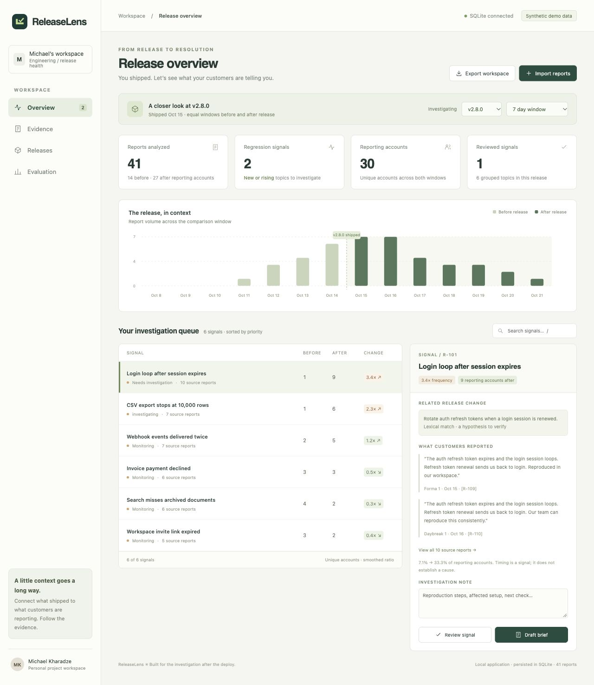
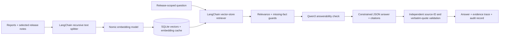

# ReleaseLens

**Release-aware customer triage with a tested LangChain RAG pipeline.** Find which problems became more common after a deployment, ask questions about the supporting evidence, and export an engineering brief.

[Public demo](https://releaselens-mk.windycandy18.chatgpt.site) · [RAG architecture and evaluation](docs/RAG.md) · [API](docs/API.md) · [Portfolio notes](docs/PORTFOLIO.md)



## What it does

- Imports support reports and public GitHub issues with validated, idempotent ingestion.
- Compares the share of unique reporting accounts in equal UTC windows around a release.
- Groups related problems, ranks new/rising topics, and preserves original evidence in engineering briefs.
- Runs **retrieval-augmented generation with LangChain**, local **Nomic embeddings**, a persistent **SQLite vector store**, and **Qwen3 4B through Ollama**.
- Shows retrieved chunks, cosine scores, source citations, cache usage, model tokens, and request timings.
- Applies retrieval thresholds, answerability checks, constrained JSON generation, and independent source/quote validation.
- Includes offline contract tests, a live-model development benchmark, visible failures from earlier iterations, and GitHub Actions.

## Run the application

Requires **Node.js 24+**. Install dependencies and start the application:

```sh
npm ci
npm run dev
```

Open [http://127.0.0.1:4317](http://127.0.0.1:4317). A new database seeds **41 authored synthetic reports** and two releases. Reports, reviews, audit events, cached embeddings, and RAG runs persist in `.data/releaselens.sqlite`.

The analytics and review workflow runs without a model. For a clean workspace:

```sh
SEED_DEMO=false DATABASE_PATH=.data/your-project.sqlite npm run dev
```

## Enable live local RAG

No hosted API key is required. The initial downloads are approximately 2.8 GB for Qwen3 4B and Nomic embeddings, plus the Ollama runtime. Models stay on your computer and are excluded from Git.

```sh
cp .env.example .env
npm run models:setup
npm run models:serve
```

Keep the model server running. In another terminal:

```sh
npm run models:pull
npm run dev
```

Open **RAG lab**, type a question, and select **Retrieve evidence and answer**. The compatibility **Generate an AI hypothesis** action now uses the same RAG pipeline. The earlier direct Together adapter has been replaced.

Automatic runtime setup supports macOS and verifies a pinned official Ollama release checksum. On Linux/Windows, install [Ollama](https://ollama.com/download) first, then use the serve/pull commands. Configuration lives in the ignored `.env`; see [.env.example](.env.example).

## RAG architecture



Chunks are 900 characters with 120-character overlap. Retrieval searches only the selected release window, uses exact cosine similarity, and returns up to four distinct evidence texts by default. The embedding cache is keyed by content and the installed model digest. A 0.60 similarity threshold is a development-calibrated heuristic, not a confidence score.

See [RAG.md](docs/RAG.md) for implementation details, measurements, and limits.

## Validation

```sh
npm run check        # TypeScript, offline tests, grouping evaluation, browser build
npm run eval:rag     # Opt-in live model benchmark; start Ollama and pull models first
```

The offline tests cover transactional imports, release boundaries, vector persistence across restart, cache invalidation, scope isolation, invalid embeddings, provider errors/timeouts, LangChain HTTP transport, structured output, citation rejection, and UI escaping. They do not download or invoke models in normal CI.

The live benchmark invokes actual local embedding and chat models through the application's HTTP API. It records model digests, runtime versions, timings, token counts, retrieved sources, reference checks, abstentions, and an instruction-injection case. Results are in [evaluation/rag-results.json](evaluation/rag-results.json). Earlier failed development runs are retained alongside the current result.

All evaluation fixtures are **authored synthetic development data**, not held-out or real-customer evidence. Exact citations do not prove semantic faithfulness. No production adoption, customer time savings, or incident reduction has been measured.

The original lexical grouping benchmark remains separate: 24 pairs, 66.7% precision, 83.3% recall, and 74.1% F1. Its metrics do not describe RAG answer quality.

## Hosted demo versus local application

The **public static demo** runs release analytics in the browser, saves changes in browser storage, and lets visitors inspect **recorded outputs from real local-model benchmark requests**. It clearly labels recorded results and does not pretend to run live inference.

The **local full-stack application** adds SQLite persistence, GitHub import jobs, and live RAG questions against local Ollama models. The public website cannot access the model server on your Mac.

## How release signals work

For each topic, count distinct reporting accounts before and after a deployment. Normalize by all reporting accounts in the corresponding window, using a 0.5 pseudocount:

```text
ratio = ((topic_after + 0.5) / (all_after + 1))
      / ((topic_before + 0.5) / (all_before + 1))
priority = topic_after × max(0, log2(ratio))
```

Both windows need reporting accounts; otherwise the system reports insufficient data. A topic absent before is new, and a ratio of at least 1.5 is rising. These are triage heuristics. Reporting accounts are not an active-user exposure denominator; a GitHub login is an account proxy. Timing and release-note overlap do not prove causality.

## Limits and project history

The server is a single-user loopback application. Production multi-tenant authentication, exposure denominators, incremental issue synchronization, durable cluster identities, and ANN-scale vector retrieval remain future work. GitHub imports inspect at most 300 records per job, report batches accept at most 1,000 records, and RAG indexes are limited to 5,000 chunks per release window.

See [development history](docs/DEVELOPMENT.md), [validation record](docs/VALIDATION.md), and [résumé wording](docs/PORTFOLIO.md). The history contains actual feature commits and PRs with their real timestamps.

Inspired by the problem space of [Open Customer Insights](https://github.com/Nutlope/open-customer-insights), with an independently implemented release-comparison and RAG workflow. No source code was copied from that project.
