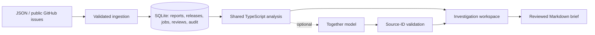

# ReleaseLens

Find the customer problems that surfaced after a release, inspect the evidence, and turn a suspected regression into a reviewable engineering brief.

## Why it exists

Customer-insight tools usually organize feedback by topic. ReleaseLens organizes the investigation around a deployment: what changed, which problems increased, and which original reports support that signal? Temporal association is a lead for investigation, not proof of a cause.

Customer feedback can rise simply because overall report volume rose. ReleaseLens compares the **share of unique reporting accounts** in equal windows around a deployment, groups related reports, ranks new or increasing topics, and links them to potentially related release changes. A brief includes the original reports, counts, and a reproduction checklist.


## Run locally

Requires **Node.js 24+**. The application has no runtime package dependencies. Development tools are installed with npm.

```sh
npm ci
npm run dev
```

Open [http://127.0.0.1:4317](http://127.0.0.1:4317). The first run seeds **41 authored, synthetic reports** across six problem areas and two example releases. Data and investigation notes persist in `.data/releaselens.sqlite`.

```sh
npm test              # Unit and real HTTP integration tests
npm run typecheck     # Check server, shared core, and browser TypeScript
npm run eval          # Recompute the 24-pair development benchmark
npm run build         # Build the static browser demo
```

For a clean workspace, start with an unused database and disable seeding:

```sh
SEED_DEMO=false DATABASE_PATH=.data/your-project.sqlite npm run dev
```

Add a release with its actual UTC deployment time, then import JSON reports or public GitHub issues. JSON import accepts an array of reports or an exported workspace. The import dialog can download an example. IDs are preserved; repeat imports skip existing IDs.

## What works

- **Release comparison:** half-open UTC windows, distinct reporting-account counts, report-share normalization, and finite ratios for zero-count baselines.
- **Deterministic grouping:** token normalization and binary cosine similarity; complete-link grouping limits chains of loosely related reports.
- **Traceable evidence:** original text, source identifiers, optional HTTPS links, and exportable Markdown engineering briefs.
- **Triage workflow:** investigating, confirmed, and dismissed states, release-scoped notes, and a server-side audit trail.
- **Ingestion:** atomic validated report batches, idempotent IDs, JSON upload, and background public GitHub imports with persisted job status.
- **Evaluation:** reproducible labeled pairs, per-case failures, a dataset checksum, a documented F1 regression gate, and GitHub Actions.
- **Optional AI hypotheses:** Together-compatible structured output with validated source IDs, bounded input, and no automatic issue publication.

## Architecture



`src/core/` is shared between the browser and Node server. `src/store.ts` owns SQLite transactions. `src/server.ts` exposes the API and static assets. `src/github.ts` performs bounded imports. `src/model.ts` validates optional model output. `src/web/app.ts` implements the workspace. The build strips TypeScript with Node's built-in API; it does not bundle a UI framework.

The **local application** uses the HTTP API and SQLite. The **hosted static demo** runs the same analysis in the browser and saves report data and review notes in browser storage. It does not provide a shared database, background GitHub jobs, or server-side AI calls. The interface identifies its active mode.

## How a signal is calculated

For each topic, count unique reporting accounts before and after the release. Divide by all unique reporting accounts in the corresponding window. The displayed ratio uses a 0.5 pseudocount:

```text
ratio = ((topic_after + 0.5) / (all_after + 1))
      / ((topic_before + 0.5) / (all_before + 1))
priority = topic_after × max(0, log2(ratio))
```

A topic with no prior reports is labeled new; otherwise, a ratio of at least 1.5 is rising. These are **heuristics**, not statistical confidence estimates. Reporting accounts are not an exposure denominator or a count of active users. GitHub logins are used as account proxies, not organizations. A release-note match is lexical overlap, not proof of a root cause.

When either entire comparison window has no reporting accounts, the engine returns **insufficient data** and omits the ratio. A zero-count topic inside an otherwise populated window can still be compared using the pseudocount.

## Evaluation and current limits

The authored 24-pair development set includes paraphrases, unrelated reports, and same-topic reports with different symptoms. The initial baseline achieved **66.7% precision, 83.3% recall, and 74.1% F1**, with five false positives and two false negatives. Reproduce it with `npm run eval`; inspect every case in `evaluation/results.json` or the Evaluation view.

This is a small **synthetic development benchmark**, not a held-out or customer-validated result. It shows the baseline's weaknesses: lexical grouping misses semantic paraphrases and can merge distinct symptoms. The F1 gate of 0.65 detects major regressions; it is not a production readiness criterion. No customer time savings, business impact, or live-model accuracy has been measured.

Complete-link grouping has quadratic cost and is intentionally bounded to small workspaces; import batches allow at most 1,000 records and GitHub jobs inspect at most 300 issue records. Existing source IDs are skipped rather than synchronized. Later-imported IDs can change a group's representative and orphan an earlier review; a production version should persist cluster identities. The local server binds to loopback and rejects cross-origin requests; it is a single-user development application, without production authentication or tenant isolation.

## Optional model analysis

Copy `.env.example` to `.env`, select a model available in your Together account, and run:

```sh
node --env-file=.env scripts/build.mjs
node --env-file=.env src/server.ts
```

Setting `TOGETHER_API_KEY` and `TOGETHER_MODEL` enables **Generate an AI hypothesis** in the signal detail. It sends the selected reports to Together and may incur provider charges. No model call occurs on startup. Unknown citation IDs and malformed responses are rejected. Valid IDs do not guarantee the hypothesis faithfully represents the sources; a person must review it. The live provider path has not been exercised without a user-supplied API key.

## Development milestones

1. Release-window analysis and deterministic report grouping.
2. SQLite storage, validated ingestion, public GitHub imports, and an HTTP API.
3. An interactive investigation workspace with source evidence and reviewed briefs.
4. A reproducible evaluation suite, CI, and deployment documentation.

The repository contains focused feature branches and real merge commits created as those stages were implemented. See [development notes](docs/DEVELOPMENT.md) for the milestone sequence and GitHub publication helper. All work retains actual timestamps; there is no fabricated contribution history.

## Portfolio notes

See [project explanation and résumé wording](docs/PORTFOLIO.md) for an interview walkthrough, measured results, and claims that still need real-world validation.

Inspired by the problem space of [Open Customer Insights](https://github.com/Nutlope/open-customer-insights), with an independently implemented release-comparison workflow. No source code has been copied from that project.
